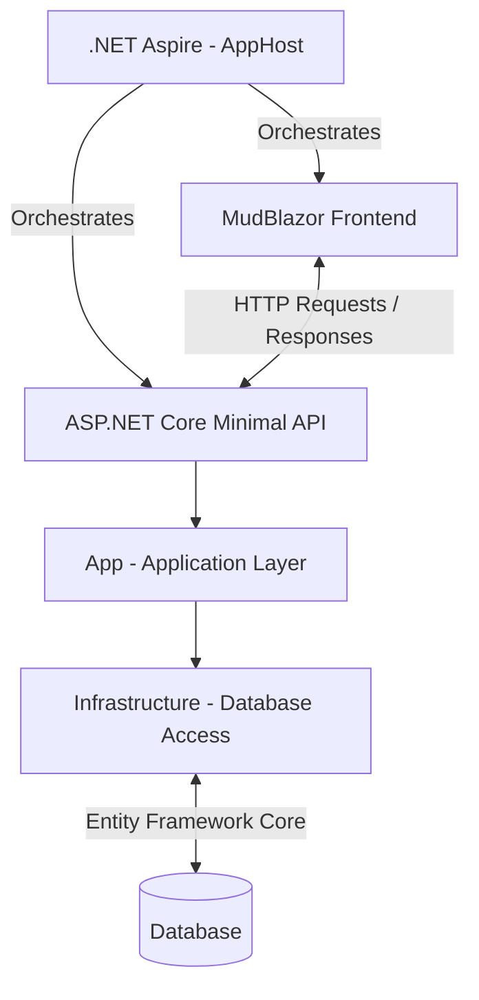

# Historical Timeline

**Historical Timeline** is a web application designed to help users visualize and explore the chronological order of historical events related to a specific topic, on diffrent level of detail.

The application allows users to create timelines and organize historical events in chronological order, making it easier to understand how different events are connected and how a particular subject has evolved over time.

## Technology Stack

The project is built using the following technologies:

- **C# / .NET** – Main programming language and application platform.
- **.NET Aspire** – For application orchestration and service management.
- **ASP.NET Core Minimal APIs** – For building lightweight and efficient HTTP APIs.
- **Entity Framework Core** – For database access and data management.
- **MudBlazor** – For building the interactive and responsive user interface.

## Architecture

Historical Timeline follows a layered architecture that separates the user interface, API endpoints, application logic, and infrastructure concerns.

The application consists of the following components:

- **Aspire AppHost** – Orchestrates application services and manages their configuration.
- **MudBlazor Frontend** – Provides the user interface for creating, managing, and visualizing historical timelines.
- **Minimal API** – Exposes HTTP endpoints and handles communication between the frontend and the application layer.
- **App** – Contains application logic and coordinates application operations.
- **Infrastructure** – Handles database access and persistence using Entity Framework Core.

### Architecture Diagram

